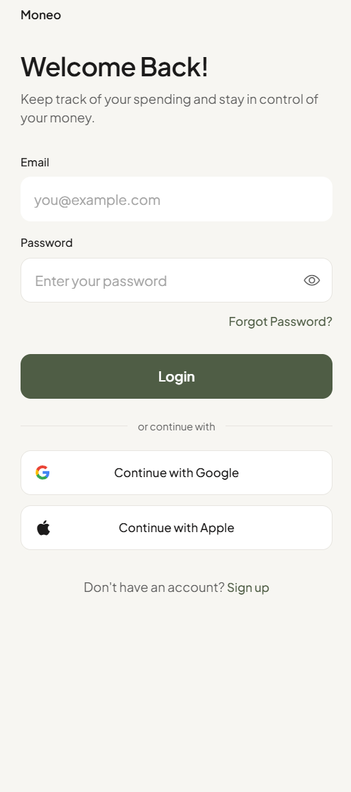
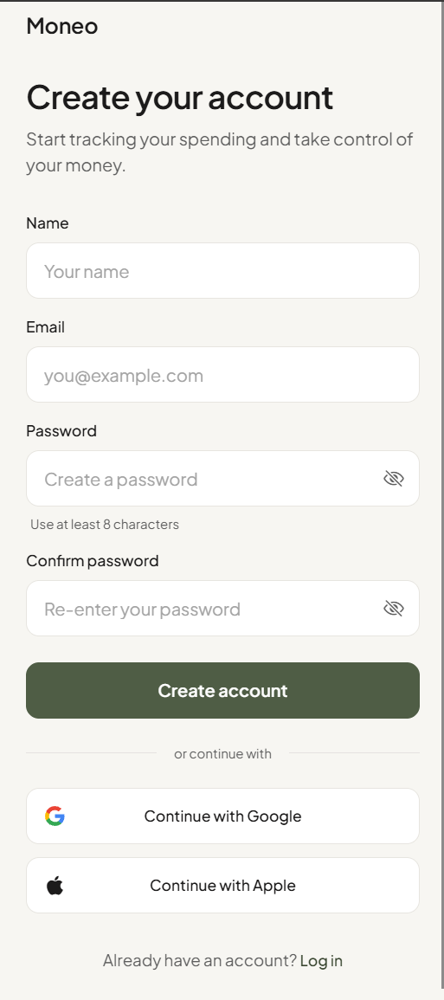
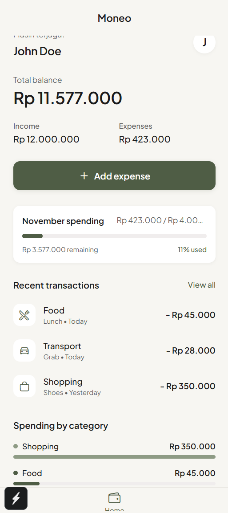
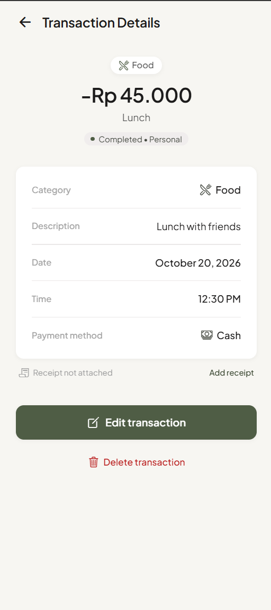
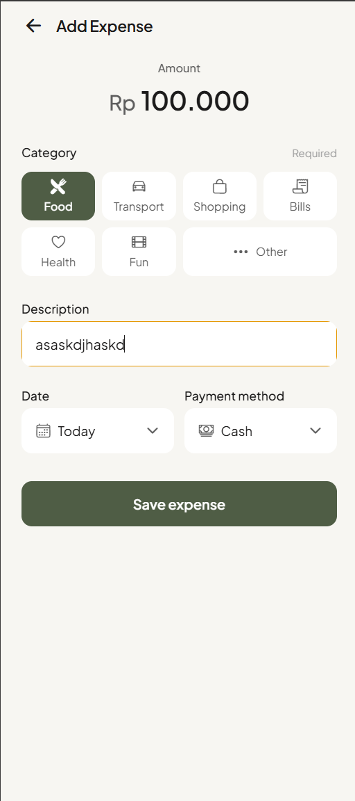

# Moneo

Moneo adalah prototipe aplikasi mobile pencatat keuangan pribadi yang dibuat dengan React Native. Seluruh data bersifat statis dan autentikasi belum diimplementasikan.

## Identitas

- Nama: Laurentius Ryan Dofani Pradita
- NIM: 2802443432
- Kelas: LB95
- Mata kuliah: COMP6923051 - Hybrid Application Development

## Tema

Finance

## Tangkapan Layar

**Auth (Register & Login)**




**Halaman Utama**



**Halaman Detail**



**Halaman Fitur Pendukung (Add Expense)**



## Cara Menjalankan

Pastikan Node.js dan Expo Go (di HP) sudah terpasang.

```bash
git https://github.com/iceyyy00/hybriddevclass.git
cd hybridapp
npm install
npx expo start
```

Scan QR code yang muncul memakai Expo Go, atau tekan `a` untuk emulator Android / `i` untuk simulator iOS.

## Video Demo

https://binusianorg-my.sharepoint.com/personal/laurentius_pradita_binus_ac_id/_layouts/15/guestaccess.aspx?share=IgAAUp80okEgQYzvrrgIvBJLAQCNwgNluupXCuikKNDQvz8&e=0DWk1d

## Penjelasan Konsep

React Native adalah framework dari Meta untuk membuat aplikasi mobile dengan JavaScript dan React. Kode JavaScript yang kita tulis dijalankan di satu thread tersendiri, lalu memerintahkan sisi native untuk membuat elemen antarmuka yang asli. Jadi `<View>` atau `<Text>` yang kita tulis benar-benar menjadi komponen native di Android dan iOS, bukan halaman web yang dibungkus. Dengan begitu, kita cukup menulis logika dan tampilan dalam JavaScript, sedangkan proses menggambar ke layar ditangani oleh masing-masing platform.

Keunggulan React Native untuk aplikasi hybrid:

1. **Satu kode untuk dua platform.** Moneo cukup ditulis sekali dan bisa dijalankan di Android maupun iOS, sehingga waktu pengerjaan lebih singkat dan tidak perlu membuat dua aplikasi terpisah.
2. **Tampilan dan performa native.** Karena dirender sebagai komponen asli, hasilnya lebih mulus dan terasa natural dibanding aplikasi berbasis webview.
3. **Pengembangan cepat.** Fast Refresh membuat perubahan kode langsung terlihat tanpa build ulang, dan ekosistem library JavaScript (npm) yang lengkap memudahkan penambahan fitur seperti ikon dan navigasi.

**Komponen** adalah potongan antarmuka yang bisa dipakai berulang. Di Moneo, setiap transaksi pada daftar ditampilkan dengan satu komponen yang sama, jadi kalau tampilan item ingin diubah, cukup diubah di satu tempat. Komponen ditulis sebagai function dan memakai Hooks. **Props** adalah data yang dikirim dari komponen induk ke komponen anak. Pada contoh di bawah, `title`, `amount`, `icon`, dan `onPress` dikirim dari layar Home, sehingga satu komponen bisa menampilkan transaksi yang berbeda-beda.

```jsx
const TransactionItem = ({ title, amount, icon, onPress }) => (
  <Pressable onPress={onPress}>
    <Ionicons name={icon} size={24} />
    <Text>{title}</Text>
    <Text>{amount}</Text>
  </Pressable>
);
```

**State** adalah data yang bisa berubah dan memicu tampilan diperbarui saat nilainya berganti. Pada layar Auth, state `isLogin` menentukan apakah form yang tampil adalah login atau register. Ketika `setIsLogin` dipanggil, React merender ulang layar dengan form yang sesuai tanpa perlu berpindah halaman. Cara kerja yang sama dipakai untuk menyimpan isi input dan pesan validasi.

```jsx
const [isLogin, setIsLogin] = useState(true);
```

**Navigasi** mengatur perpindahan antar layar. Saat sebuah transaksi ditekan, aplikasi berpindah dari Home ke layar Detail sambil membawa id transaksi sebagai parameter. Layar Detail lalu memakai id tersebut untuk mencari data transaksi yang sesuai dan menampilkan informasinya secara lengkap. Dengan cara ini, satu layar Detail sudah cukup untuk semua transaksi.

```jsx
router.push({ pathname: '/detail', params: { id: item.id } });
```

## Analisis Kebutuhan

### Masalah

Banyak orang, terutama mahasiswa dan pekerja muda, tidak sadar uangnya habis ke mana karena pengeluaran kecil jarang dicatat. Mencatat manual di buku atau catatan HP terasa merepotkan, sehingga akhirnya ditinggalkan.

### Target Pengguna

Mahasiswa dan pekerja muda yang ingin mengatur keuangan harian dengan cara yang sederhana dan cepat.

### Kebutuhan Pengguna

1. Pengguna dapat mendaftar dan masuk ke aplikasi.
2. Pengguna dapat melihat saldo, total pemasukan, dan total pengeluaran.
3. Pengguna dapat memantau budget bulanan.
4. Pengguna dapat melihat daftar transaksi terbaru.
5. Pengguna dapat melihat rincian dari satu transaksi.
6. Pengguna dapat mencatat pengeluaran baru.
7. Pengguna dapat melihat pengeluaran per kategori.

### Pemetaan Kebutuhan ke Layar dan Komponen

| No | Kebutuhan | Layar | Komponen |
|----|-----------|-------|----------|
| 1 | Daftar dan masuk | Auth | Formulir Login dan Signup |
| 2 | Lihat saldo, income, expenses | Halaman Utama | Ringkasan saldo, pemasukan, dan pengeluaran |
| 3 | Pantau budget bulanan | Halaman Utama | Kartu budget bulanan dengan progress bar |
| 4 | Lihat transaksi terbaru | Halaman Utama | Daftar transaksi terbaru |
| 5 | Lihat rincian transaksi | Detail | DetailRow dan DeleteConfirmModal |
| 6 | Catat pengeluaran baru | Add Expense | AmountInput, CategoryChip, dan PickerField |
| 7 | Lihat pengeluaran per kategori | Halaman Utama | Rincian pengeluaran per kategori dengan progress bar |

### Alasan Keputusan Desain

Saya memilih warna hijau sebagai warna utama Moneo karena hijau identik dengan uang, jadi pengguna langsung merasa ini aplikasi keuangan. Supaya tidak terlalu mencolok, saya pakai hijau zaitun yang gelap dengan latar krem, sehingga tampilannya terasa hangat dan santai, bukan seperti aplikasi bank yang serius dan bikin tegang. Spasi antar elemen juga sengaja dibuat lega supaya layar tidak terasa sesak. Warna merah saya simpan khusus untuk tombol Delete, jadi begitu ada merah, pengguna langsung sadar itu aksi yang berbahaya.

Di halaman utama, saldo ditaruh paling atas dengan ukuran paling besar karena itu hal pertama yang ingin diketahui pengguna. Income dan expenses ada tepat di bawahnya. Tombol Add expense dibuat lebar dan berwarna penuh karena ini aksi yang paling sering dipakai. Progress bar budget memberi gambaran cepat apakah pengeluaran bulan ini masih aman. Recent transactions hanya menampilkan tiga item dengan ikon kategori, dan sisanya bisa dilihat lewat View all, supaya layar tidak terlalu penuh.

Di layar Add Expense, nominal ditampilkan besar di atas dan kategori dibuat berupa tombol yang bisa dipilih dengan satu ketukan. Tanggal dan metode pembayaran sudah punya nilai awal (Today dan Cash), jadi pengguna hanya perlu mengisi yang benar-benar penting dan pencatatan terasa cepat.

Di layar Detail, semua informasi dikelompokkan dalam satu kartu dengan label di kiri dan nilai di kanan agar mudah dipindai. Tombol Edit dan Delete sengaja dipisah, dengan Delete di bawah dan berwarna merah, supaya tidak tertekan secara tidak sengaja.

Layar Auth dibuat sederhana dengan spasi yang lega. Ikon mata pada kolom password membantu pengguna memeriksa ketikannya, dan petunjuk minimal 8 karakter ditampilkan langsung di bawah kolom password pada form Register.

### Rencana Pengembangan

- Menghubungkan autentikasi ke backend sungguhan
- Menyimpan data transaksi ke database atau penyimpanan lokal
- Fitur edit dan hapus transaksi
- Grafik pengeluaran
- Notifikasi ketika budget hampir habis